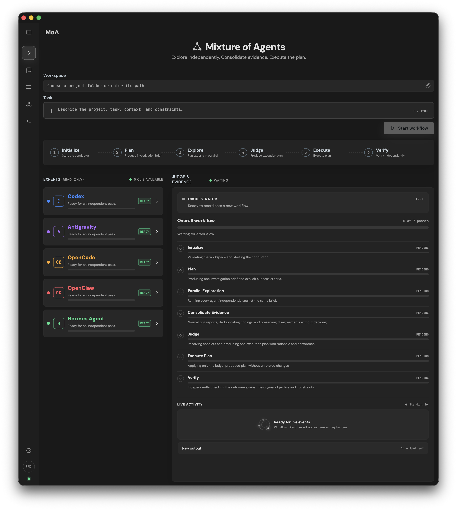
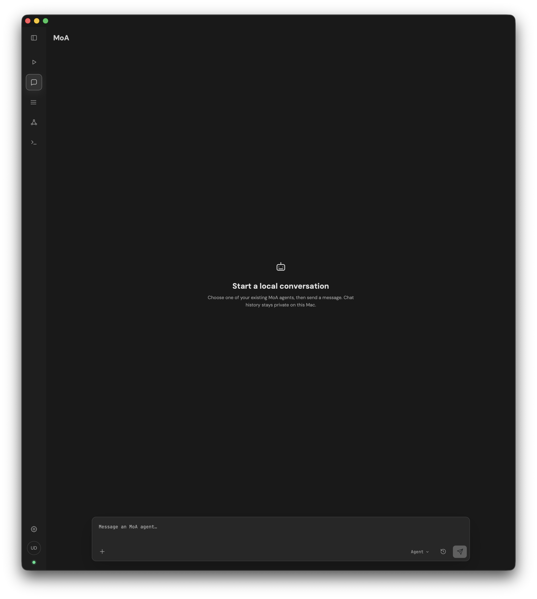
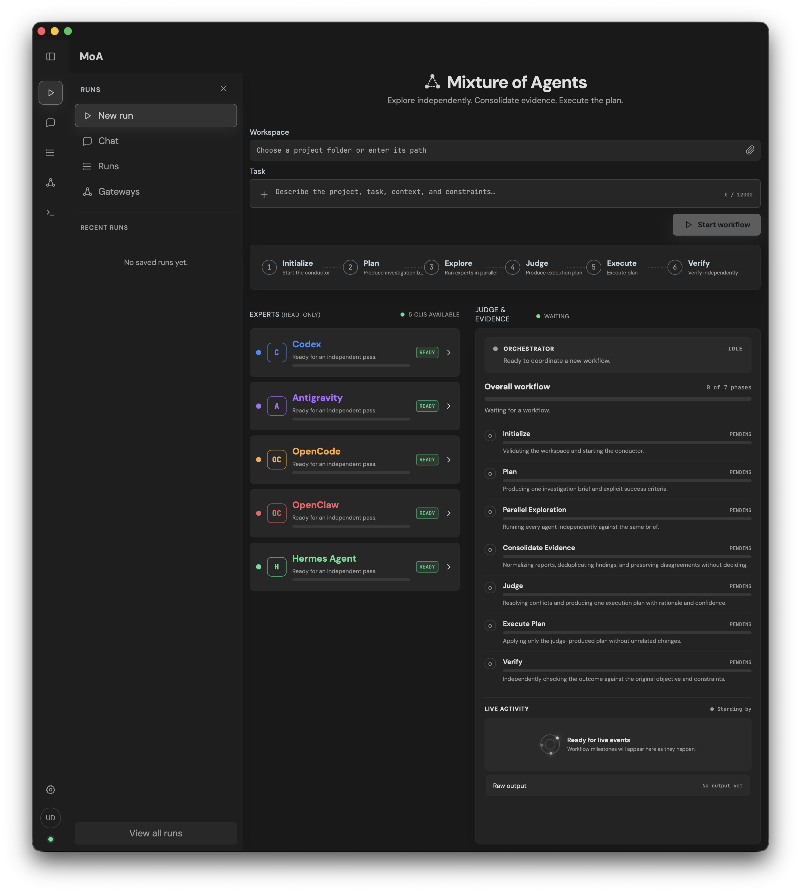

# MoA

MoA is a local-first macOS agent-orchestration harness for running multiple CLI agents against the same investigation brief, consolidating their evidence, producing one judged execution plan, applying that plan, and independently verifying the result.

It wraps the existing `MoA.command` workflow in a React web interface and a native macOS application shell. The service binds exclusively to localhost and installs into `$HOME/.MoA`.

## Screenshots

### Orchestrated workflow



### Local CLI-agent chat



### Expandable project navigation



## What it does

MoA coordinates a staged workflow:

```text
Initialize
  -> Plan
  -> Parallel Exploration
  -> Consolidate Evidence
  -> Judge
  -> Execute Plan
  -> Verify
```

The Orchestrator controls the workflow but is not treated as another sequential stage.

- **Initialize** validates the workspace and starts the conductor.
- **Plan** produces one investigation brief and explicit success criteria.
- **Parallel Exploration** runs Codex, Antigravity, and OpenCode independently against that same brief, with no cross-talk.
- **Consolidate Evidence** normalizes reports, removes duplicates, and preserves consensus and disagreements without choosing a solution.
- **Judge** compares the preserved independent recommendations, probes material disagreements against their source evidence when needed, and produces one execution plan with rationale and a confidence level.
- **Execute Plan** applies only that plan, avoids unrelated changes, and writes a structured record of the changes and checks performed.
- **Verify** launches a fresh read-only verifier that checks the result against the original objective and constraints. Successful verification completes normally, and non-actionable failure stops normally. An actionable corrective failure pauses the workflow and presents the verifier summary, findings, proposed scope, affected areas, attempt number, and possible Judge impact for explicit user approval. No corrective Executor starts before approval. Approval runs only the scoped corrective Executor followed by a fresh Verify; stopping finishes without further workspace changes. If the approved correction later exposes a genuine conflict with the plan, the Judge gets one bounded re-evaluation.

Progress is derived from real process events, report files, exit statuses, and server-sent events. Unmeasurable work uses indeterminate progress rather than fabricated percentages.

OpenCode is admitted when its local model catalog contains a compatible headless model. MoA uses `opencode/deepseek-v4-flash-free` explicitly and retries once with `opencode/mimo-v2.5-free` if the primary model fails; both can be overridden with `MOA_OPENCODE_MODEL` and `MOA_OPENCODE_FALLBACK_MODEL`. This avoids OpenCode's unreliable implicit model selection while keeping the pass bounded and independent.

The local service acts as a small task-scoped control plane. It admits one active workflow at a time, sequences and briefly buffers lifecycle events for UI reconnection, bounds captured process output, caches CLI capability probes, and writes critical JSON state atomically so interrupted writes cannot leave partial status records. Every CLI process group is supervised by inactivity and maximum-runtime limits. A silent read-only conductor stage is retried once from persisted intent; a silent executor is terminated and restarted once from the current workspace and saved plan without reviving the old process. Terminal workflow status is persisted so refreshes and service reconnections cannot leave the UI indefinitely active.

Every new run also owns a versioned `run.json` contract and an append-only `events.jsonl` lifecycle journal. The contract records stage capabilities, timestamps, outcomes, CLI versions, artifact hashes, and Git evidence. Before execution MoA records the repository baseline; after execution it writes a change ledger so the verifier can distinguish pre-existing user work from executor changes. Execution is admitted exactly once: only an untouched Judge-complete `awaiting_execution` run can cross the boundary. Terminal status is written before the final inventory so every recorded artifact hash describes the stored terminal bytes.

Saved projects are resumable without mutating history. Resume is also the supported recovery and retry path after any execution attempt. It creates a new schema-v2 run with a unique ID, parent/root linkage, incremented revision, and hashes pointing to inherited evidence. MoA compares the current repository with the parent run's final Git evidence, requires confirmation when drift is detected, starts from intent with a fresh Plan pass, records a fresh pre-execution baseline, and always verifies new work independently. It never revives an old CLI process or writes into the parent run directory.

## Features

- Independent Codex, Antigravity, and OpenCode explorer runs, with optional OpenClaw and Hermes Agent passes
- Persistent Orchestrator status and seven-stage lifecycle monitor
- Per-explorer activity, completion, failure, and availability states
- Evidence-backed execution plan summary
- Explicit separation between planning, independent exploration, consolidation, judgment, execution, and verification
- Optional autonomous handoff from the Judge to execution and independent verification
- Approval-gated corrective recovery with durable pause state and stale-decision protection
- Bounded Judge re-evaluation when a corrective pass exposes a plan/verification conflict
- Local CLI-agent chat sessions with private history, images, documents, and expandable composer
- Embedded CLI gateways for configured agents
- Process-group watchdogs, bounded runtime recovery, and persisted terminal workflow status
- Expandable raw process diagnostics
- Project history browser with linked revisions, verification status, resumable runs, and multi-select deletion
- Task attachments for validated documents and images, persisted as private run-scoped evidence
- Versioned run manifests, durable lifecycle journals, and workspace change ledgers
- Configurable CLI integrations and optional terminal launchers
- Dark, light, system, and custom colour schemes
- Reduced-motion and keyboard-accessible UI states
- Responsive desktop and mobile layouts
- Native macOS wrapper with a seamless title bar
- Self-healing per-user service with health-aware retries and automatic restart
- Localhost-only HTTP service

## Architecture

```text
React + Vite UI
      |
      | HTTP + Server-Sent Events
      v
Node.js local service
      |
      +-- MoA.command conductor
      +-- Codex CLI
      +-- Antigravity CLI
      +-- OpenCode CLI
      +-- saved reports in ~/Documents/MoA Runs

Native Swift wrapper
      |
      +-- starts and embeds http://127.0.0.1:4317
      +-- per-user LaunchAgent keeps the service available
```

The browser client never receives private model reasoning. It displays lifecycle metadata, CLI output, saved evidence, the judge-produced execution plan, the executor's change record, and the independent verification report.

Each saved run directory is the workflow's scoped memory: immutable intake and brief artifacts flow forward into independent reports, consolidated evidence, the execution plan, the executor change record, and verification. MoA intentionally avoids a shared mutable scratchpad during exploration so one agent's reasoning cannot influence another's independent pass.

A continuation inherits only the context required to reason safely: the original objective, immutable artifact references and hashes, the latest completed stage, and repository drift evidence. The new revision has its own manifest, lifecycle journal, reports, execution record, and verification result. Parents with surviving children cannot be deleted alone, protecting project-chain provenance.

Codex exploration, judging, and verification remain read-only. Only the explicitly activated Execute stage receives workspace-scoped write access; it also receives network access so non-interactive package resolution and dependency validation do not become false blockers.

Run storage is private to the current user: the runs root and each run directory use mode `0700`, while generated manifests, reports, and logs inherit mode `0600`. Git evidence contains repository state and hashes rather than file contents; hashing is limited to 10 MiB per file and 64 MiB per capture.

MoA deliberately does not maintain cross-project personal memory or automatically rewrite reusable skills. Those capabilities are valuable in a general personal-agent environment, but they would weaken the provenance and isolation guarantees of this project-focused harness. Durable learning should be introduced only with explicit review, versioning, confidence, and rollback controls.

## Requirements

- macOS 14 Sonoma or newer
- Apple Silicon (`arm64`) or Intel (`x86_64`) Mac
- Node.js `^20.19.0` or `>=22.12.0`, with npm
- Xcode Command Line Tools (`xcode-select --install`) for the native Swift wrapper
- At least two supported CLI tools available on `PATH`

Built-in integrations:

- `codex`
- `agy` (Antigravity)
- `opencode`

Additional CLI launchers can be registered from Settings. Custom integration data is stored locally in `$HOME/.MoA/cli-integrations.json` with user-only permissions and is not committed.

OpenClaw and Hermes Agent can be enabled independently under **Settings → Optional explorers** when their binaries are installed. Both are off by default and participate only in the parallel Explore stage. They receive the same brief, cannot replace the judge/executor/verifier, are instructed not to delegate or use prior conversational memory, and their failure does not block the workflow while at least two explorer reports still succeed. The selected roster is stored privately in `$HOME/.MoA/optional-explorers.json` and recorded in each new run manifest.

## Installation

This repository is private. Sign in to GitHub first, then clone it somewhere outside `$HOME/.MoA`.

With GitHub CLI:

```bash
gh auth login
gh repo clone UillihansDias/MoA
cd MoA
./install.sh
```

Or with authenticated Git:

```bash
git clone https://github.com/UillihansDias/MoA.git
cd MoA
./install.sh
```

The installer:

1. Resolves the current user's home directory at runtime.
2. Creates `$HOME/.MoA` when necessary.
3. Copies the application without Git metadata, caches, build output, secrets, or local configuration.
4. Installs dependencies and builds the Vite application.
5. Builds the native `MoA.app` wrapper.
6. Registers and starts a private per-user LaunchAgent with automatic recovery.
7. Adds `$HOME/.MoA/MoA.app` to the current user's macOS Dock without creating duplicate entries on reinstall.
8. Opens the installed application.

The native application is compiled for the current Mac architecture. No administrator privileges are required because the source, application bundle, configuration, service definition, and run history all remain within the current user account.

Automated or headless installations can skip Dock registration and launching:

```bash
MOA_SKIP_SERVICE=1 MOA_SKIP_DOCK=1 MOA_SKIP_LAUNCH=1 ./install.sh
```

`MOA_SKIP_SERVICE=1` is intended for packaging checks and non-interactive validation; a normal desktop installation should keep the LaunchAgent enabled.

Start MoA with:

```bash
"$HOME/.MoA/MoA Web UI.command"
```

The interface is then available at `http://127.0.0.1:4317` and through `$HOME/.MoA/MoA.app`.

The installer registers a private per-user LaunchAgent for the local service. Opening `MoA.app` also checks service health, starts it when necessary, and retries the WebView after transient startup failures, so launching from the Dock does not depend on first running the `.command` launcher.

### Installation locations

| Item | Per-user location |
| --- | --- |
| Source and runtime | `/Users/<username>/.MoA` |
| Native application | `/Users/<username>/.MoA/MoA.app` |
| LaunchAgent | `/Users/<username>/Library/LaunchAgents/com.uillihansdias.moa-webui.plist` |
| Saved workflows | `/Users/<username>/Documents/MoA Runs` |
| Chat sessions | `/Users/<username>/.MoA/chat-sessions` |
| Local service log | `/Users/<username>/.MoA/moa-webui.log` |

`install.sh` resolves the actual home directory from `$HOME`; it never assumes a particular username.

### Updating

Pull the latest repository version and run the installer again:

```bash
git pull --ff-only
./install.sh
```

Reinstallation preserves private CLI configuration, optional-explorer settings, chat sessions, staged runtime storage, and saved runs while replacing application source and rebuilding the app.

### Troubleshooting installation

- Run `node --version`; supported versions are Node 20.19+ or 22.12+.
- Run `xcode-select --install` if Swift build tools are missing.
- Run `"$HOME/.MoA/service-manager.sh" status` to check the local service.
- Review `$HOME/.MoA/moa-webui.log` if the application cannot connect.
- Re-run `MOA_SKIP_DOCK=1 ./install.sh` when installing from a non-interactive session.

## Development

Install dependencies and start the development server:

```bash
npm install
npm run dev
```

Production-style local run:

```bash
npm run build
npm start
```

Validation:

```bash
npm test
npm run check
```

Rebuild the native wrapper after changing `macos/MoAApp.swift`:

```bash
./build-macos-app.sh
```

## Local API

The Node service exposes a deliberately narrow localhost API:

| Endpoint | Purpose |
| --- | --- |
| `GET /api/health` | Constant-time local-service health check |
| `GET /api/status` | CLI availability and active workflow state |
| `GET /api/events` | Server-sent orchestration events |
| `POST /api/run` | Start analysis and judging |
| `POST /api/attachments` | Privately stage one validated document or image for the next run |
| `DELETE /api/attachments/:id` | Remove a staged attachment |
| `POST /api/execute` | Execute and independently verify one eligible, never-attempted plan |
| `POST /api/run/:id/stop` | Stop an active process |
| `POST /api/runs/:name/correction/approve` | Approve one current scoped corrective attempt |
| `POST /api/runs/:name/correction/stop` | Finish a paused workflow without applying the proposed correction |
| `GET /api/runs` | List saved runs |
| `GET /api/runs/:name` | Read saved evidence and diagnostics |
| `POST /api/runs/:name/resume` | Validate parent evidence and start a linked project revision |
| `DELETE /api/runs` | Delete selected saved runs |
| `POST /api/select-workspace` | Open the native macOS folder picker |
| `GET/POST/DELETE /api/cli-integrations` | Manage local CLI launchers |
| `PUT /api/optional-explorers/:id` | Enable or disable installed OpenClaw/Hermes explorer passes |
| `POST /api/gateway/:id` | Open a configured CLI launcher |

Workspace paths, run names, CLI commands, and launchers are validated server-side. The service listens on `127.0.0.1` only.

The resume request is `{ "instruction": "Add the requested changes", "mode": "continue" }`. If the repository changed after the parent run, the API returns `409 workspace_drift` with bounded drift evidence; repeat the request with `"confirmDrift": true` only after explicit user confirmation. See [`docs/API.md`](docs/API.md) for the full contract.

`POST /api/execute` requires a normalized `awaiting_execution` manifest, a non-empty Judge plan, no execution footprint, and pending Execute/Verify stages. Schema v2 also requires every stage through Judge to be complete; compatible schema-v1 records may omit stage metadata but may not contradict eligibility. Lifecycle conflicts return structured `409` responses, while missing or incompatible manifests return `422`. Runs are immutable after an attempt; bounded corrective passes remain within that single attempt, and further work uses a linked continuation. Service-restart orphan reconciliation is not claimed or implemented.

## Data and privacy

MoA is local-first:

- Workspaces and reports remain on the machine.
- Saved evidence is written to `$HOME/Documents/MoA Runs`.
- Saved run directories and newly generated artifacts are restricted to the current user.
- Uploaded documents and images are size/type bounded, hashed, staged under opaque IDs, and moved into the new run before agent access.
- Chat history is stored locally under `$HOME/.MoA/chat-sessions` and is not committed.
- Custom CLI configuration remains in `$HOME/.MoA/cli-integrations.json`.
- Environment files, build output, caches, application bundles, and local configuration are ignored by Git.
- The application does not require a hosted database or cloud backend.

## Repository layout

```text
src/                    React interface
server.mjs              Local orchestration service and API
MoA.command             Portable staged conductor workflow
stage-runner.mjs        Process-group supervision for CLI stages
macos/                   Native macOS wrapper source
docs/images/             Repository screenshots
install.sh               Installer for $HOME/.MoA
build-macos-app.sh       Native wrapper build script
MoA Web UI.command      Local service launcher
service-manager.sh       LaunchAgent installation and health recovery
service-process.sh       Restricted local-service process entry point
```

## Security notes

- The server is bound to loopback and is not intended for remote exposure.
- State-changing browser requests are restricted to the local MoA origin.
- Task attachments are limited to 10 files, 20 MiB per file, and 50 MiB total; executable and unsupported extensions are rejected.
- CLI definitions do not accept shell argument strings.
- Custom configuration is written with mode `0600`.
- The installer excludes environment files and user-specific configuration.
- The installer excludes chat sessions, temporary files, staged uploads, and local run data from source copies and Git.
- The installed `$HOME/.MoA/MoA.command` is the source of truth for the underlying conductor workflow.

## License

No license has been declared. All rights are reserved unless a license is added to the repository.
